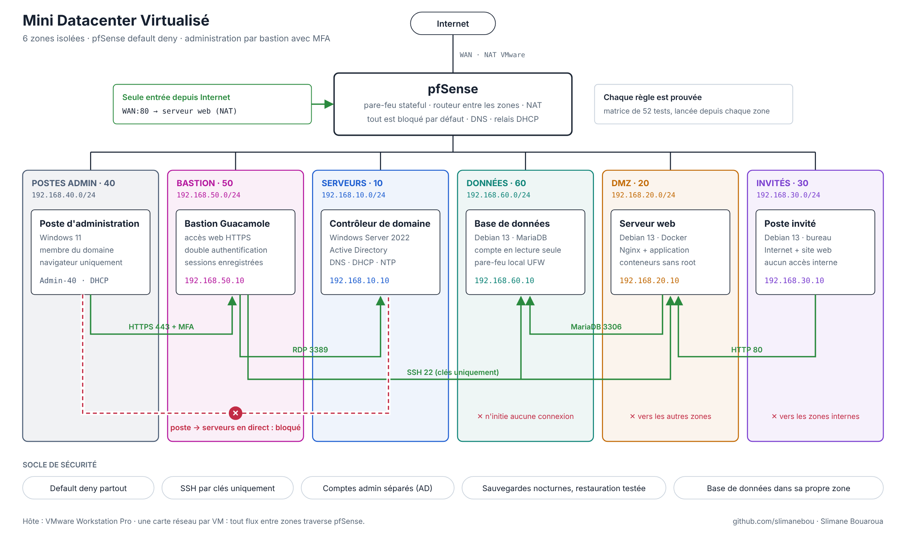
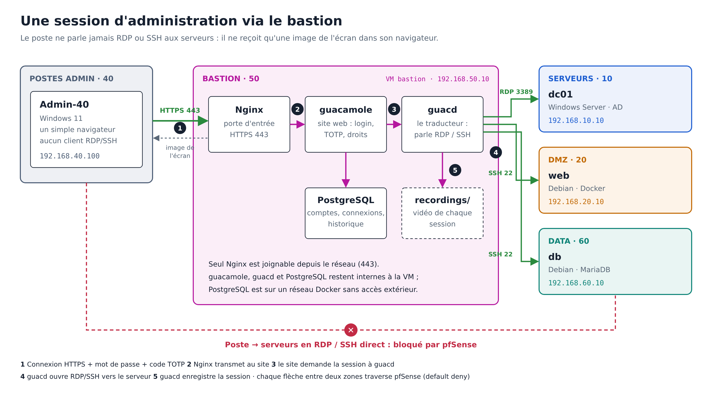

# Mini Datacenter Virtualisé


Un mini datacenter de **7 machines virtuelles**, réparti en **6 zones de confiance** derrière un pare-feu **pfSense** qui bloque tout par défaut. L'administration passe **uniquement par un bastion** (Apache Guacamole) avec double authentification et enregistrement des sessions. Chaque flux autorisé ou interdit est **prouvé par un test**, et les sauvegardes sont **automatisées et restaurées**.



> Schéma interactif (étapes de construction, matrice de flux, plan d'adressage) : [`docs/schema/schema-suivi.html`](docs/schema/schema-suivi.html)

---

## Ce que démontre ce projet

| Compétence | Mise en œuvre |
|---|---|
| **Segmentation réseau** | 6 réseaux isolés, un rôle par zone, routage et filtrage centralisés sur pfSense |
| **Filtrage « default deny »** | Règles explicites par zone, alias, `! RFC1918` pour n'ouvrir qu'Internet, NAT sortant et port forwarding |
| **Accès à privilèges** | Bastion Guacamole : HTTPS, MFA TOTP, sessions enregistrées et rejouables, IP réelle de l'administrateur tracée |
| **Active Directory** | Domaine `datacenter.lan`, DNS intégré, DHCP via relais pfSense, NTP, comptes du quotidien et d'administration séparés |
| **Linux et conteneurs** | Debian 13, Docker Compose, conteneurs sans root en lecture seule, image scannée (Trivy) |
| **Défense en profondeur** | Base de données : pare-feu réseau + pare-feu local (UFW) + compte SQL en lecture seule. DC : pfSense + pare-feu Windows |
| **Exploitation** | Sauvegardes nocturnes (timers systemd) collectées sur une autre machine, restauration testée sur incident simulé |
| **Méthode** | Construction par phases, une preuve par fonctionnalité, difficultés documentées |

## Pourquoi une version 2

La [version 1](https://github.com/slimanebou/Mini-Datacenter-Virtualise-ProxmoxVE) (projet TER de Master 1, en trinôme) a été publiée puis relue. Un CTO a signalé un risque de **mouvement latéral** : les postes d'administration partageaient la zone des serveurs. La relecture a mis en évidence d'autres faiblesses, toutes corrigées et testées ici :

| Faiblesse de la v1 | Correction en v2 |
|---|---|
| Postes d'admin dans la zone des serveurs, RDP/SSH directs | Zone dédiée + bastion obligatoire ; accès direct bloqué |
| Base de données dans la zone d'administration | Zone DONNÉES dédiée, joignable uniquement par le serveur web sur 3306 |
| Règles « any » : la DMZ et les invités atteignaient d'autres zones | Destination `! RFC1918` : seul Internet est ouvert |
| DMZ et invités pouvaient joindre l'interface de pfSense | Seule la zone admin accède à l'interface |
| DNS de l'Active Directory exposé aux zones non fiables | DMZ et invités utilisent le DNS de pfSense |
| Le web n'utilisait pas la base (flux 3306 non justifié) | Application Flask qui lit réellement MariaDB |
| Snapshots utilisés comme seules sauvegardes | Sauvegardes automatisées, stockées ailleurs, restauration testée |

## Architecture

| Zone | Réseau | Machine | Rôle |
|---|---|---|---|
| Serveurs · 10 | 192.168.10.0/24 | `Dc-10` — Windows Server 2022 | Active Directory, DNS, DHCP, NTP |
| DMZ · 20 | 192.168.20.0/24 | `Web-20` — Debian 13 | Nginx + Flask/Gunicorn en conteneurs |
| Invités · 30 | 192.168.30.0/24 | `Guest-30` — Debian 13 (bureau) | Internet et site web uniquement |
| Postes admin · 40 | 192.168.40.0/24 | `Admin-40` — Windows 11 | Poste du domaine, IP par relais DHCP |
| Bastion · 50 | 192.168.50.0/24 | `Bastion-50` — Debian 13 | Guacamole (Nginx, webapp, guacd, PostgreSQL) |
| Données · 60 | 192.168.60.0/24 | `Db-60` — Debian 13 | MariaDB |
| Toutes | WAN + 6 réseaux | `pfSense-gw` | Pare-feu, routeur, NAT, DNS, relais DHCP |

Chaque VM n'a **qu'une seule carte réseau** : tout flux entre deux zones traverse pfSense. pfSense est en `.1` dans chaque réseau.

### Chemin d'administration



## Résultats

| Mesure | Résultat |
|---|---|
| Matrice de flux | **52 tests** lancés depuis chaque zone et depuis Internet : **52 conformes** |
| RDP/SSH direct du poste admin vers les serveurs | **Bloqué** (testé) |
| Restauration de la base après suppression d'une table | **0,13 s**, depuis la copie stockée sur le bastion |
| Restauration de la configuration pfSense | Règle supprimée puis restaurée depuis `config.xml` |
| Image du serveur web (Trivy, HIGH/CRITICAL corrigeables) | Système : 0 ; Python : **5 → 0** après retrait de `pip` |
| Authentification SSH par mot de passe | Refusée (`Permission denied (publickey)`) |
| Ressources | 7 VMs, ≈ 19 Go de RAM sur un hôte de 32 Go |

Détail de la matrice : [`docs/09-pare-feu.md`](docs/09-pare-feu.md).

## Documentation par phase

Chaque document décrit l'objectif, la configuration appliquée, les preuves et les difficultés rencontrées.

| Phase | Sujet | Document |
|---|---|---|
| 0 | Préparation : plan d'adressage, nommage, conventions | [00-preparation](docs/00-preparation.md) |
| 1 | Réseaux VMware : NAT + 6 LAN Segments | [01-reseaux-vmware](docs/01-reseaux-vmware.md) |
| 2 | pfSense : interfaces, NAT, DNS | [02-pfsense](docs/02-pfsense.md) |
| 3 | Contrôleur de domaine | [03-serveurs](docs/03-serveurs.md) |
| 4 | Poste d'administration et relais DHCP | [04-postes-admin](docs/04-postes-admin.md) |
| 5 | Zone DONNÉES : MariaDB durcie | [05-data](docs/05-data.md) |
| 6 | DMZ : application en conteneurs | [06-dmz](docs/06-dmz.md) |
| 7 | Invités et template généralisé | [07-invites](docs/07-invites.md) |
| 8 | Bastion Guacamole | [08-bastion](docs/08-bastion.md) |
| 9 | Pare-feu final et matrice de flux | [09-pare-feu](docs/09-pare-feu.md) |
| 10 | Durcissement et sauvegardes | [10-durcissement-sauvegardes](docs/10-durcissement-sauvegardes.md) |

## Structure du dépôt

```
mini-datacenter-virtualise-v2/
├── README.md
├── docs/
│   ├── 00-…md à 10-…md         une page par phase
│   ├── img/                    captures
│   └── schema/                 schémas et schéma interactif (HTML)
└── configs/                    fichiers de configuration réels, par machine
    ├── db/                     MariaDB, UFW, sauvegarde
    ├── web/                    application (Compose, Nginx, Flask)
    ├── bastion/                Guacamole (Compose, Nginx), collecte des sauvegardes
    └── 10-durcissement.conf    durcissement SSH              
```

Aucun secret n'est versionné : mots de passe (`.env`), clés privées, dumps et `config.xml` de pfSense sont exclus par le `.gitignore`.

## Reproduire le projet

**Prérequis :** VMware Workstation Pro, environ 20 Go de RAM libres, et les images pfSense CE 2.7.2, Windows Server 2022, Windows 11 Pro et Debian 13.

Suivre les phases **dans l'ordre**, de 0 à 10. Chaque phase s'appuie sur la précédente (pfSense avant les serveurs, l'Active Directory avant le poste d'administration, etc.). Les VMs Debian sont des clones d'un template **généralisé** (identifiant machine et clés SSH régénérés, réseau neutre), décrit en phase 7.

Ordre de démarrage : `pfSense-gw`, puis `Dc-10`, puis les autres. Arrêt dans l'ordre inverse.

## Proxmox VE et VMware

Le projet a été conçu pour **Proxmox VE** (hyperviseur de type 1), puis déployé sur **VMware Workstation Pro** (type 2) à cause des limites matérielles. Les concepts se transposent directement :

| Besoin | VMware Workstation (ce projet) | Proxmox VE |
|---|---|---|
| Réseaux isolés | LAN Segments (un switch virtuel par zone) | Bridge `vmbr` « VLAN aware » + tags 802.1Q |
| Sortie Internet | VMnet8 (NAT) | Bridge relié à la carte physique |
| Modèle de VM | Clone complet d'un template généralisé | Template + cloud-init |
| Retour arrière | Snapshots | Snapshots (ZFS/LVM-thin) |
| Sauvegarde des VMs | Hors périmètre (sauvegardes applicatives) | Proxmox Backup Server |

Les LAN Segments offrent une isolation équivalente à des VLAN d'accès, sans tag 802.1Q ni trunk.

## Limites connues

- **Sauvegardes centralisées sur le bastion** : la règle 3-2-1 demanderait une copie hors site et immuable.
- **Pas de blocage automatique des tentatives de connexion dans Guacamole** : le module `guacamole-auth-ban` n'est pas inclus dans l'image 1.5.5. Le risque est limité par le MFA.
- **Comptes Guacamole locaux** : une authentification LDAPS sur l'Active Directory serait l'étape suivante.
- **Certificat HTTPS auto-signé** sur le bastion (pas de PKI interne).
- **Pas de supervision** (Zabbix ou Uptime Kuma, dans une zone dédiée) ni de sauvegarde de l'état système du DC.
- L'administration du bastion lui-même (SSH depuis la zone admin) n'est pas enregistrée par Guacamole.


Version 1 réalisée en trinôme avec A. Merabtene et L. Abdessalam (TER M1, UVSQ / Université Paris-Saclay). Version 2 (refonte, bastion, matrice de flux, sauvegardes) réalisée seul.