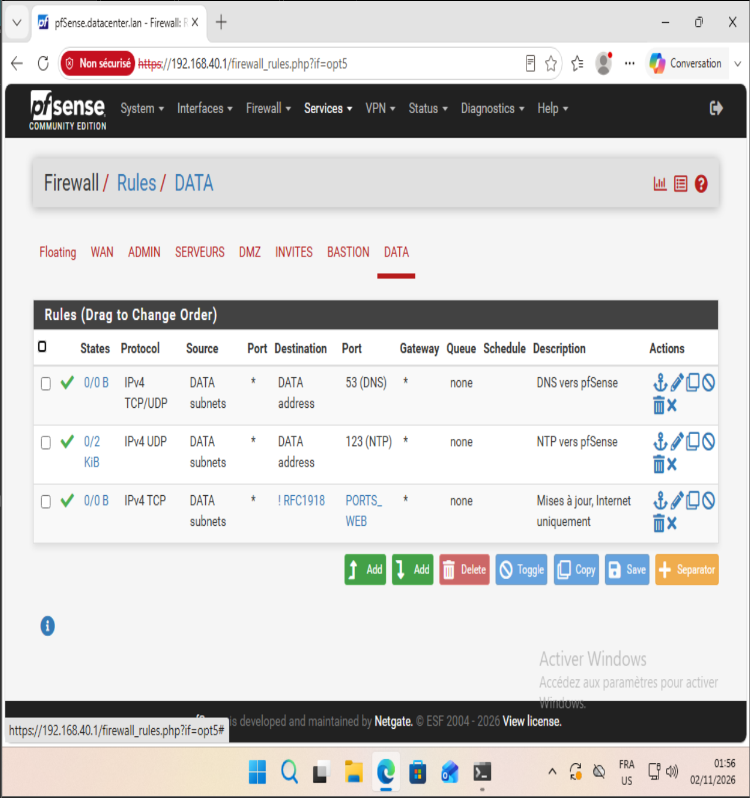

# Phase 5 — DATA (Db-60)

Objectif : placer la base de données dans sa propre zone et la protéger par trois couches indépendantes (pare-feu réseau, pare-feu local, droits SQL). Cette phase corrige la faille n°5 du TER, où la base se trouvait dans la zone Admin.

## Configuration

Debian 13 (clone complet du template) — 2 Go RAM, 2 vCPU, une carte sur `LAN-60-DATA`.

| Élément | Valeur |
|---|---|
| Nom / IP | db01 / 192.168.60.10/24, passerelle 192.168.60.1 |
| DNS / heure | pfSense (192.168.60.1) |
| MariaDB | `bind-address = 192.168.60.10` |
| Base | `appdb`, table `services` |
| Compte applicatif | `app_web`@`192.168.20.10`, `SELECT` sur `appdb.*` uniquement |
| UFW | deny entrant par défaut ; 3306 depuis 192.168.20.10 ; 22 depuis 192.168.50.10 ; 22 depuis 192.168.40.0/24 (temporaire, retiré en phase 9) |

### Règles pfSense (interface DATA)

Alias : `RFC1918` (10.0.0.0/8, 172.16.0.0/12, 192.168.0.0/16) et `PORTS_WEB` (80, 443).

| # | Action | Proto | Source | Destination | Port | Rôle |
|---|---|---|---|---|---|---|
| 1 | Pass | TCP/UDP | DATA subnets | DATA address | 53 | DNS vers pfSense |
| 2 | Pass | UDP | DATA subnets | DATA address | 123 | NTP vers pfSense |
| 3 | Pass | TCP | DATA subnets | ! RFC1918 | PORTS_WEB | Mises à jour, Internet uniquement |

Tout le reste est bloqué implicitement. La règle 3 corrige la faille n°4 du TER : une destination « any » aurait aussi ouvert les autres zones internes.

## Les trois couches

| Couche | Ce qu'elle empêche |
|---|---|
| pfSense | La zone DATA ne peut initier aucune connexion vers les autres zones |
| MariaDB | Écoute limitée à une IP ; compte utilisable depuis web01 seulement, en lecture seule |
| UFW | Le port 3306 n'est ouvert qu'au serveur web |

## Preuves

| Test | Résultat |
|---|---|
| `ss -tlnp \| grep 3306` | `192.168.60.10:3306` (pas `0.0.0.0`) |
| `SELECT user, host FROM mysql.user` | `app_web@192.168.20.10`, aucun compte anonyme |
| `SHOW GRANTS FOR app_web` | `USAGE` + `SELECT ON appdb.*` |
| `ufw status verbose` | actif, deny entrant par défaut, 3 règles |
| `curl -sI https://deb.debian.org` | HTTP/2 200 |
| Connexion vers 192.168.10.10:445 | BLOQUE |
| `timedatectl timesync-status` | serveur 192.168.60.1, décalage ≈ 4 ms |
| `Test-NetConnection 192.168.60.10 -Port 3306` depuis Admin-40 | Ping OK, TCP False : pfSense laisse passer, UFW bloque |

Fichiers de configuration : `configs/db01/50-server.cnf`, `configs/db01/ufw-status.txt`.

Snapshot : `P05-db01-ok`.

## Difficultés

- **machine-id du clone** : `systemd-machine-id-setup` a réutilisé l'identifiant du template, conservé en mémoire dans `/run/machine-id`. Solution : générer un identifiant neuf avec `systemd-id128 new > /etc/machine-id`.
- **Adresse 169.254.x.x** : le client DHCP du template (dhcpcd) s'attribuait une adresse de secours faute de serveur DHCP dans la zone. La configuration statique dans `/etc/network/interfaces` le supprime.
- **SSH injoignable** : pfSense-gw et Dc-10 étaient éteints. Ordre de démarrage retenu : pfSense, puis Dc-10, puis les autres VMs.
- **Console sans copier-coller** : seules 2 commandes sont tapées dans la console (IP provisoire), tout le reste se fait en SSH depuis Admin-40.
- **`sudo` à distance** : `ssh hôte "sudo …" > fichier` échoue, car sudo a besoin d'un terminal pour le mot de passe. Solution : écrire le fichier sur la VM, puis le copier avec `scp`.
- **Encodage** : la redirection `>` de Windows PowerShell 5 écrit en UTF-16. Le fichier devenait illisible ; `scp` copie les octets tels quels.