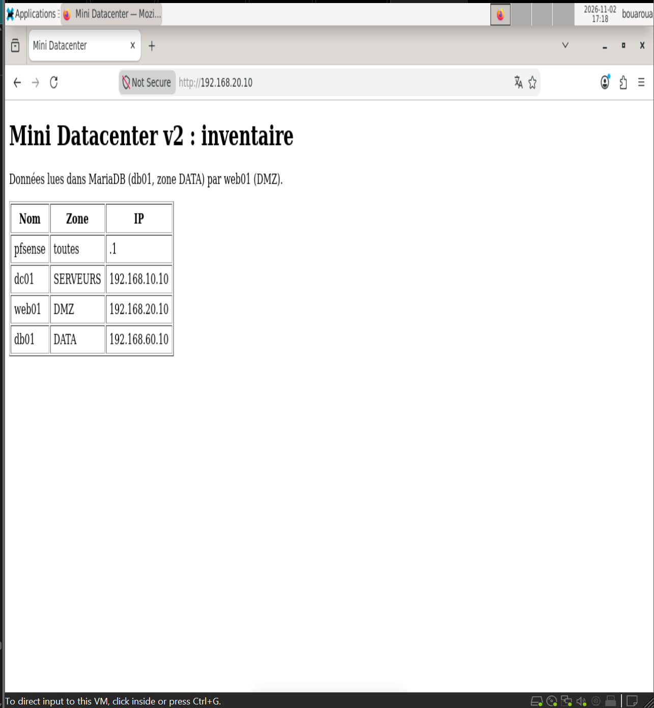
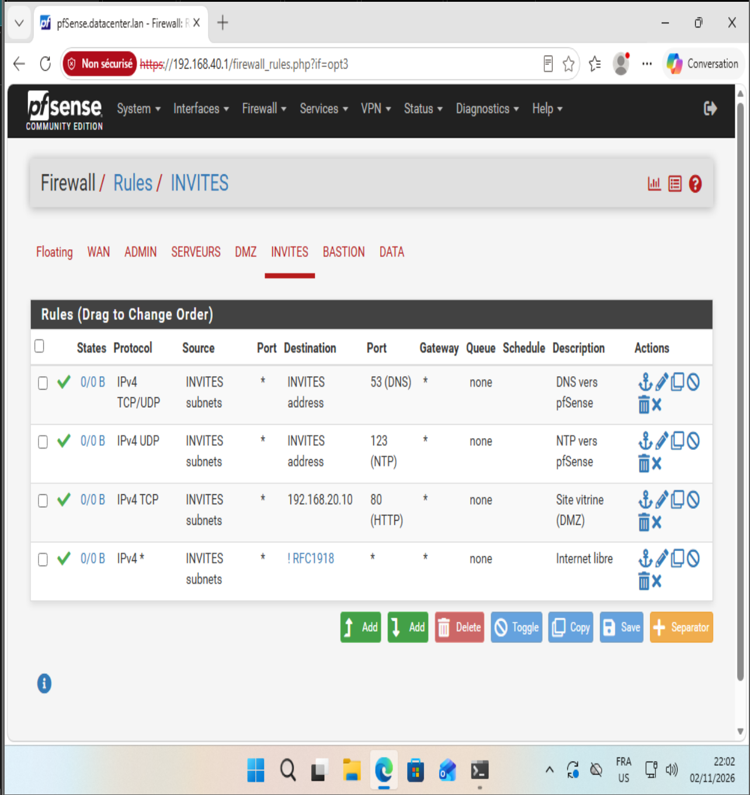

# Phase 7 — Invités (Guest-30)

Objectif : offrir aux utilisateurs non fiables Internet et le site vitrine, et rien d'autre. Cette phase corrige les failles n°6 (DNS de l'AD exposé aux invités) et n°10 (confusion entre routage et port forwarding) du TER. C'est aussi le premier clone issu du template généralisé.

## Configuration

Debian 13 (clone du template généralisé) + XFCE, LightDM et Firefox — 2 Go RAM, 2 vCPU, une carte sur `LAN-30-INVITES`. Nom d'hôte `guest`, IP 192.168.30.10/24, passerelle, DNS et NTP sur 192.168.30.1. La machine n'est pas membre du domaine.

### Règles pfSense (interface INVITES)

| # | Action | Proto | Source | Destination | Port | Rôle |
|---|---|---|---|---|---|---|
| 1 | Pass | TCP/UDP | INVITES subnets | INVITES address | 53 | DNS vers pfSense |
| 2 | Pass | UDP | INVITES subnets | INVITES address | 123 | NTP vers pfSense |
| 3 | Pass | TCP | INVITES subnets | 192.168.20.10 | 80 | Site vitrine (DMZ) |
| 4 | Pass | any | INVITES subnets | ! RFC1918 | any | Internet libre |

L'accès au site vitrine se fait par **routage** inter-zones (règle 3). Le port forwarding ne concerne que les connexions arrivant par le WAN.

## Template généralisé

Avant ce clone, le template a été préparé une fois pour toutes :

| Problème rencontré en phases 5 et 6 | Correction dans le template |
|---|---|
| Carte en NAT : un clone oublié contournait pfSense | Carte sur un segment vide `LAN-TEMPLATE` |
| dhcpcd créait une adresse 169.254 et effaçait la route | `iface ens33 inet manual`, service dhcpcd désactivé |
| machine-id identique sur tous les clones | `/etc/machine-id` vidé : nouvel identifiant généré au premier démarrage |
| Clés SSH identiques | Clés supprimées ; `ssh-keygen -A` exécuté avant sshd au démarrage (drop-in systemd) |

C'est l'équivalent de Sysprep sous Windows ou de cloud-init en cloud.

## Preuves

| Test | Résultat |
|---|---|
| `ip -br a` / `ip route` | 192.168.30.10 seule, route par défaut vers 192.168.30.1 |
| Site vitrine | Inventaire affiché dans Firefox sur guest (4 lignes lues dans MariaDB) |
| `curl -sI https://deb.debian.org` | HTTP/2 200 |
| `getent hosts dc01.datacenter.lan` | introuvable : le DNS de l'AD n'est pas exposé |
| Invités → DC:445, poste admin:445, base:3306, web:22, GUI pfSense:443 | BLOQUE ×5 |

Snapshot : `P07-guest-ok`.

## Difficultés

- **DNS en échec** : la première installation a échoué (« Temporary failure resolving ») car elle a été lancée avant la création de la règle DNS de la zone. Les journaux pfSense montraient le blocage `192.168.30.10 → 192.168.30.1:53`.
- **Commandes collées d'un bloc** : un `reboot` collé avec `apt install` a interrompu l'installation. Le redémarrage se lance seul, une fois le prompt revenu.
- **Interface graphique absente** : avec `--no-install-recommends`, le serveur X (`xserver-xorg`) n'était pas installé, et le template démarrait en `multi-user.target`. Correction : installation de `xserver-xorg`, `systemctl set-default graphical.target` et activation de LightDM.
- **Test du site** : `grep -c` compte les lignes et non les occurrences ; le tableau HTML tient sur une seule ligne. Le bon comptage est `grep -o "<tr>" | wc -l`.