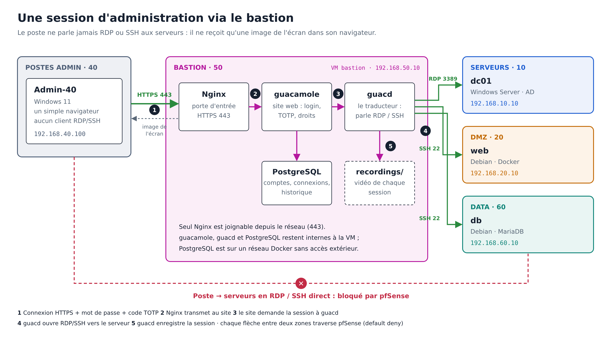
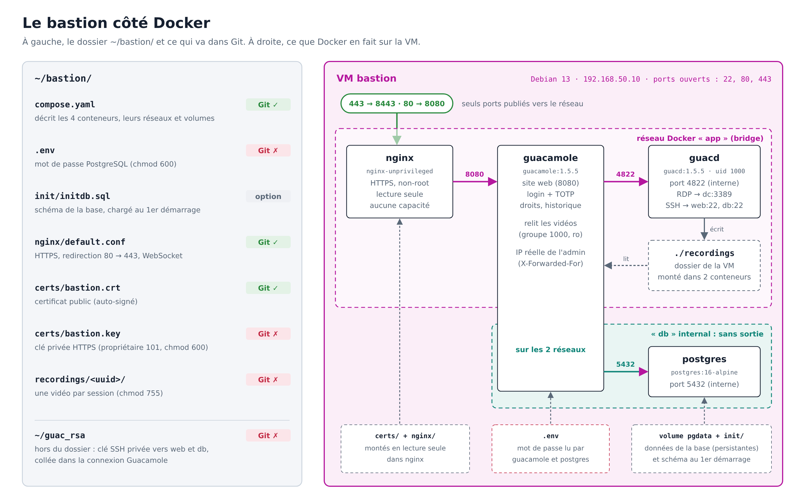
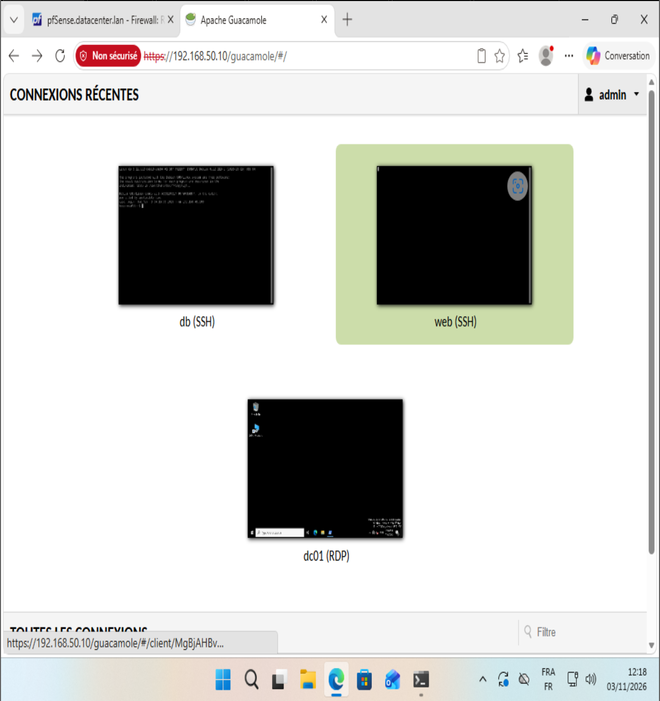
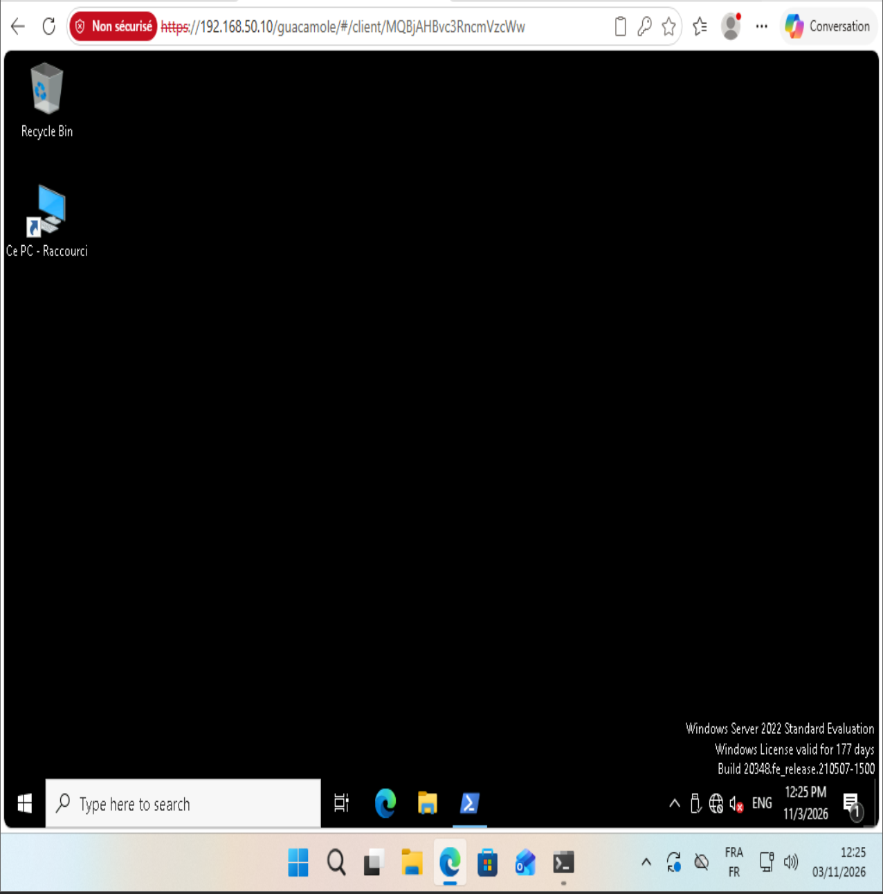
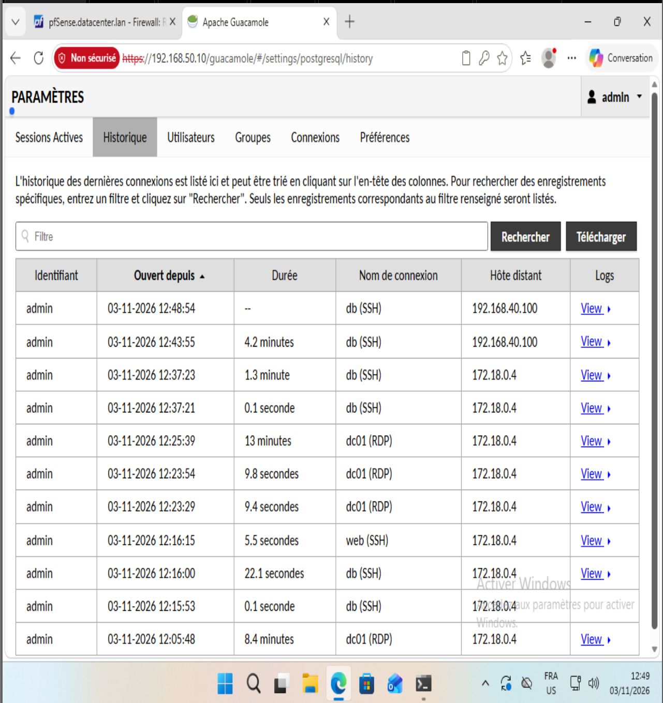
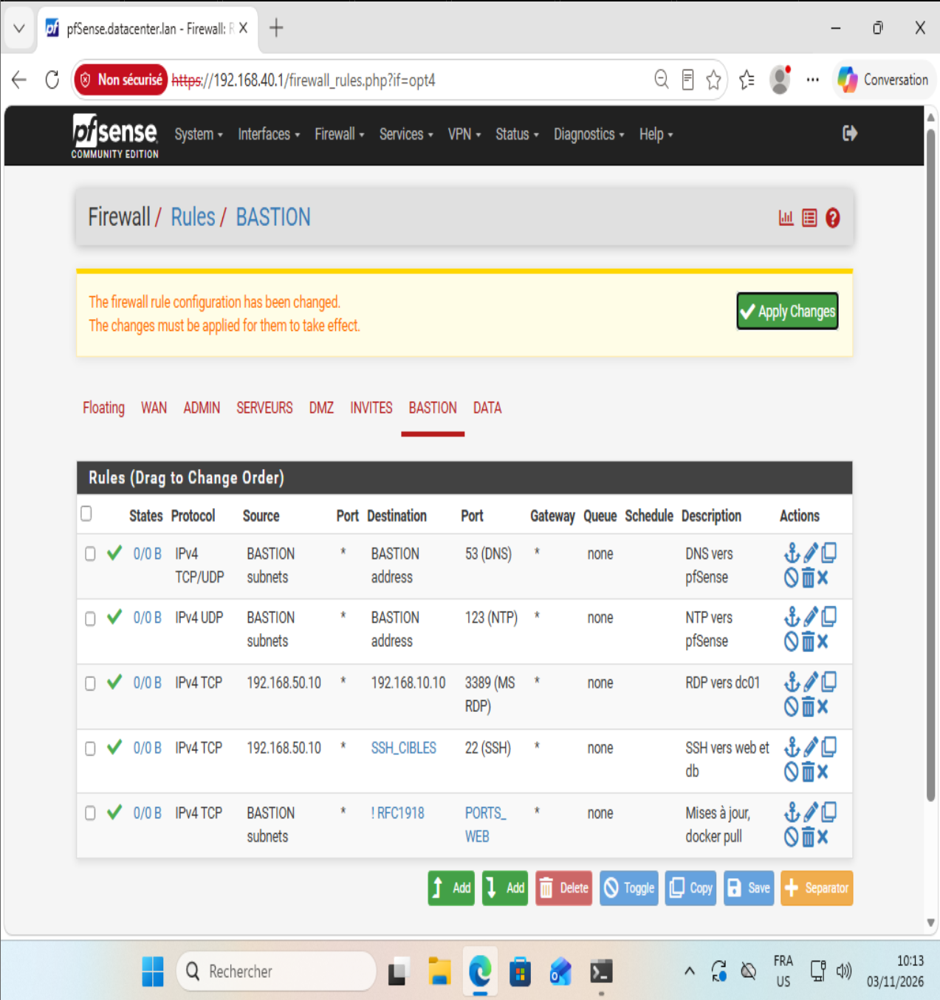

# Phase 8 — Bastion (Bastion-50)

Objectif : remplacer l'accès direct des postes d'admin aux serveurs par un point de passage unique, authentifié en deux facteurs et enregistré. C'est la réponse à la remarque du CTO sur le mouvement latéral.

## Principe

Un bastion (ou « jump server ») est le seul chemin autorisé vers les serveurs : poste (40) → HTTPS → bastion (50) → RDP/SSH → serveurs. En entreprise, c'est le rôle des solutions PAM (Wallix, CyberArk) ou d'Azure Bastion. Apache Guacamole en est l'équivalent open source, sans client à installer : tout passe par le navigateur.

## Architecture

| Conteneur | Rôle | Exposition |
|---|---|---|
| Nginx (`nginx-unprivileged`) | Reverse proxy HTTPS, redirection 80 → 443 | 80, 443 (seuls ports publiés) |
| guacamole 1.5.5 | Webapp : authentification, TOTP, droits, historique | interne (8080) |
| guacd 1.5.5 | Traduit RDP/SSH vers le protocole Guacamole, enregistre les sessions | interne (4822) |
| PostgreSQL 16 | Utilisateurs, connexions, historique | réseau Docker `internal` (aucun accès extérieur) |

Debian 13 (clone du template généralisé) — 3 Go RAM, 2 vCPU, une carte sur `LAN-50-BASTION`. Nom d'hôte `bastion`, IP 192.168.50.10/24.

Fichiers : `configs/bastion/` (sans `.env`, ni clé privée, ni enregistrements).

## Sécurité mise en place

| Mesure | Mise en œuvre |
|---|---|
| MFA | `TOTP_ENABLED=true` : code à usage unique à chaque connexion |
| Compte par défaut | `guacadmin` supprimé après création d'un administrateur nominatif |
| Traçabilité | Enregistrement de chaque session (`${HISTORY_PATH}/${HISTORY_UUID}`), relecture dans l'historique |
| IP réelle de l'admin | `REMOTE_IP_VALVE_ENABLED=true` : Guacamole lit `X-Forwarded-For` envoyé par Nginx |
| Authentification SSH | Clé RSA dédiée (format PEM), déposée sur web et db ; jamais dans Git |
| RDP | NLA, compte du domaine |
| Base isolée | Réseau Docker `db` en `internal: true` |
| Proxy | HTTPS (TLS 1.2/1.3), `server_tokens off`, conteneur non-root, lecture seule, sans capacités |

### Règles pfSense (interface BASTION)

| # | Action | Proto | Source | Destination | Port | Rôle |
|---|---|---|---|---|---|---|
| 1 | Pass | TCP/UDP | BASTION subnets | BASTION address | 53 | DNS |
| 2 | Pass | UDP | BASTION subnets | BASTION address | 123 | NTP (indispensable au TOTP) |
| 3 | Pass | TCP | 192.168.50.10 | 192.168.10.10 | 3389 | RDP vers dc |
| 4 | Pass | TCP | 192.168.50.10 | SSH_CIBLES (20.10, 60.10) | 22 | SSH vers web et db |
| 5 | Pass | TCP | BASTION subnets | ! RFC1918 | PORTS_WEB | Mises à jour, images Docker |

## Preuves

| Test | Résultat |
|---|---|
| `docker compose ps` | 4 conteneurs Up, guacd healthy |
| `ss -tlnp` | seuls 22, 80, 443 en écoute |
| `curl -sI http://localhost` | 301 vers HTTPS |
| `curl -skI https://localhost/guacamole/` | 200 |
| Bastion → dc:3389, web:22, db:22 | OUVERT ×3 |
| Bastion → dc:445, poste admin:445, db:3306, guest:22 | BLOQUE ×4 |
| Sessions | RDP sur dc et SSH sur web et db depuis le navigateur d'Admin-40 |
| Historique | IP source 192.168.40.100 et relecture de chaque session |

Snapshot : `P08-bastion-ok`.

## Limites (à ce stade)

- La zone 40 conserve la règle « LAN → any » : le RDP direct du poste vers dc est encore possible. Il sera interdit et testé en phase 9.
- Comptes Guacamole locaux : une authentification LDAP sur l'AD serait l'étape suivante.
- Certificat auto-signé (pas de PKI interne).
- Le bastion est un point unique de défaillance et une cible critique : il sera sauvegardé et durci en phase 10.

## Difficultés

- **Port 8443 dans l'URL** : c'est le port du conteneur Nginx, publié en 443 sur la VM. De plus, la redirection `/` → `/guacamole/` ajoutait ce port interne. Correction : `absolute_redirect off` (redirections relatives).
- **`compose.yaml` abîmé au collage** d'un long bloc dans le terminal. Vérification systématique avec `docker compose config --quiet`.
- **`sudo` refusé après `usermod -aG sudo`** : un nouveau groupe n'est pris en compte qu'à la connexion suivante (comme le groupe `docker`).
- **IP source 172.18.0.4 dans l'historique** : c'était l'IP du conteneur Nginx. Sans `REMOTE_IP_VALVE_ENABLED`, l'audit ne montrait pas le vrai poste.
- **Enregistrements invisibles** : guacd (UID 1000) créait des dossiers en mode 750, illisibles par la webapp (UID 1001). Correction : `group_add: ["1000"]` pour la webapp, et dossier `recordings` ramené de 777 à 755.
- **Version Nginx visible sur le port 80** : `server_tokens off` n'était appliqué qu'au bloc HTTPS.
- **502 après recréation de la webapp** : Nginx garde l'ancienne IP du conteneur ; il faut le redémarrer.