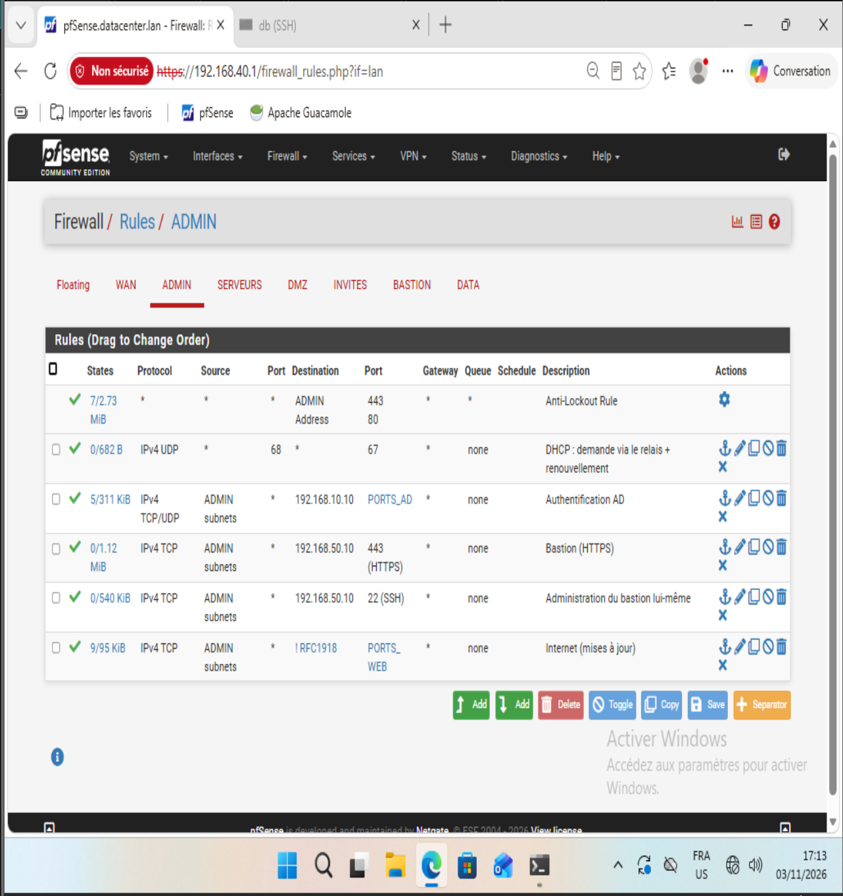
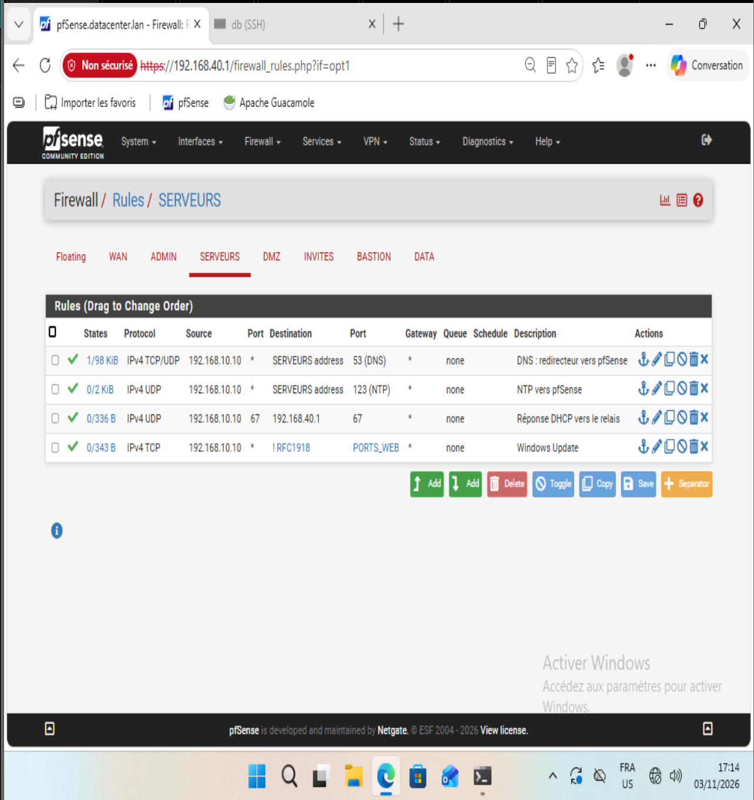
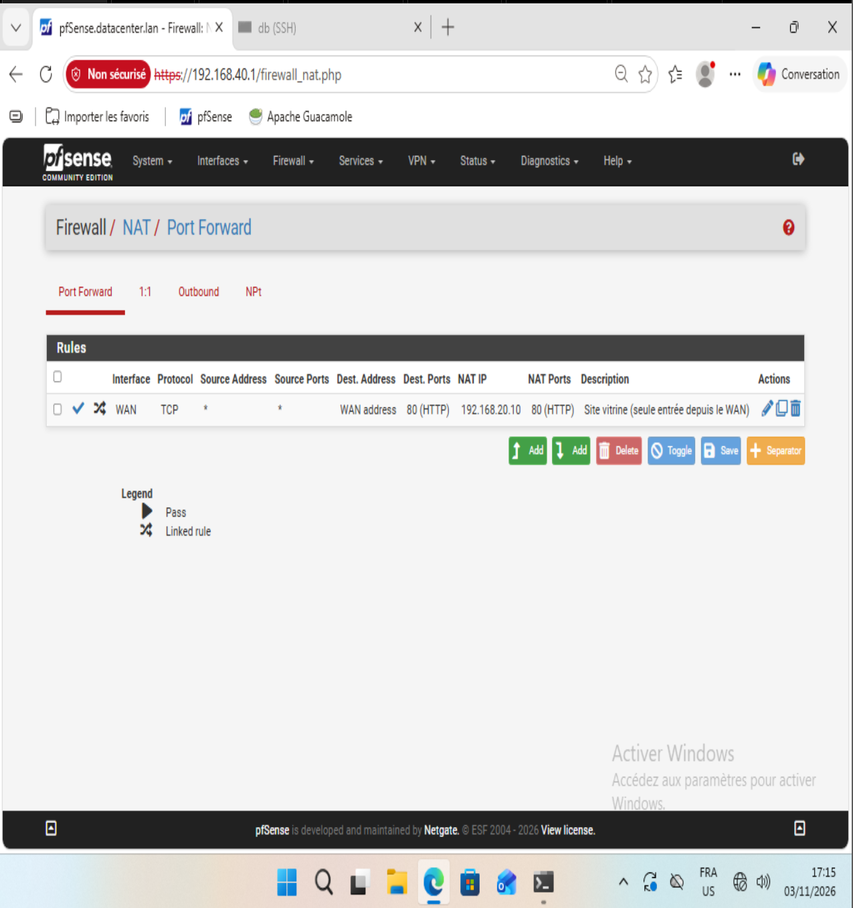
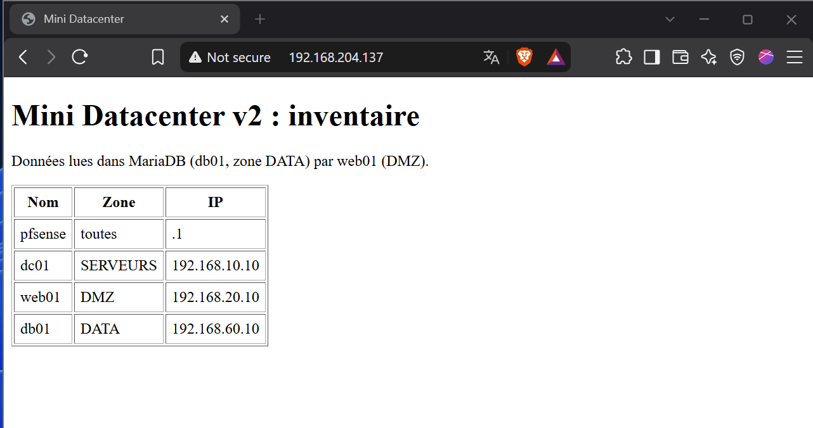

# Phase 9 — Pare-feu final et matrice de flux

Objectif : fermer les derniers accès trop larges, rendre le bastion obligatoire, ouvrir la seule entrée depuis le WAN, puis **prouver** chaque règle par un test depuis chaque zone.

## Ce qui a changé

| Avant | Après |
|---|---|
| Zone ADMIN : règle par défaut « LAN → any » (RDP/SSH direct vers les serveurs possible) | Règles explicites : DHCP, authentification AD, bastion, Internet ; plus aucun accès d'administration direct |
| Zone SERVEURS : règles temporaires (`easyrule`) | 4 règles définitives et décrites, dont Windows Update |
| Aucune entrée depuis le WAN | Port forwarding WAN:80 → 192.168.20.10:80 (site vitrine) |
| UFW de db : SSH autorisé depuis la zone 40 | SSH autorisé depuis le bastion uniquement |

Sauvegardes avant modification : snapshot `P09-pfsense-avant-regles` + export `config.xml` (conservé hors Git, car il contient des empreintes de mots de passe).

## Alias

| Alias | Type | Contenu |
|---|---|---|
| `RFC1918` | Networks | 10.0.0.0/8, 172.16.0.0/12, 192.168.0.0/16 |
| `PORTS_WEB` | Ports | 80, 443 |
| `SSH_CIBLES` | Hosts | 192.168.20.10, 192.168.60.10 |
| `PORTS_AD` | Ports | 53, 88, 123, 135, 389, 445, 464, 636, 3268, 3269, 49152-65535 |

`PORTS_AD` ne contient ni 3389 (RDP) ni 5985 (WinRM) : l'administration du DC passe obligatoirement par le bastion.

## Règles par zone

### ADMIN (40)
| # | Proto | Source | Destination | Port | Rôle |
|---|---|---|---|---|---|
| — | | * | ADMIN address | 443, 80 | Anti-lockout (GUI pfSense) |
| 1 | UDP | any:68 | any | 67 | DHCP via le relais + renouvellement direct auprès du DC |
| 2 | TCP/UDP | ADMIN subnets | 192.168.10.10 | PORTS_AD | Authentification AD |
| 3 | TCP | ADMIN subnets | 192.168.50.10 | 443 | Bastion (Guacamole) |
| 4 | TCP | ADMIN subnets | 192.168.50.10 | 22 | Administration du bastion lui-même |
| 5 | TCP | ADMIN subnets | ! RFC1918 | PORTS_WEB | Internet |

### SERVEURS (10)
| # | Proto | Source | Destination | Port | Rôle |
|---|---|---|---|---|---|
| 1 | TCP/UDP | 192.168.10.10 | SERVEURS address | 53 | Redirecteur DNS vers pfSense |
| 2 | UDP | 192.168.10.10 | SERVEURS address | 123 | NTP |
| 3 | UDP | 192.168.10.10:67 | 192.168.40.1 | 67 | Réponse DHCP vers le relais |
| 4 | TCP | 192.168.10.10 | ! RFC1918 | PORTS_WEB | Windows Update |

### WAN
| Proto | Destination | Redirection | Rôle |
|---|---|---|---|
| TCP | WAN address:80 | 192.168.20.10:80 | Site vitrine, seule entrée (règle de filtrage associée automatiquement) |

Règle automatique complémentaire : **Block bogon networks** (adresses source réservées ou non attribuées). La règle *Block private networks* est volontairement désactivée, car le WAN du lab est lui-même dans un réseau privé (VMnet8). La règle de filtrage associée au port forwarding affiche la destination `192.168.20.10` : pfSense applique la traduction NAT avant le filtrage.

Les règles des zones DMZ, INVITÉS, DATA et BASTION sont décrites dans les phases 5 à 8 et restent inchangées.

## Matrice de flux testée

Tests TCP effectués **depuis chaque zone** (délai 2 s, IPv4). Tous les résultats obtenus correspondent aux résultats attendus.

| Depuis | Vers | Port | Attendu | Obtenu |
|---|---|---|---|---|
| ADMIN | dc (LDAP / Kerberos / SMB) | 389 / 88 / 445 | OUVERT | ✅ |
| ADMIN | bastion | 443 | OUVERT | ✅ |
| ADMIN | Internet | 443 | OUVERT | ✅ |
| ADMIN | dc (RDP) | 3389 | **BLOQUÉ** | ✅ |
| ADMIN | dc (WinRM) | 5985 | BLOQUÉ | ✅ |
| ADMIN | db / web (SSH) | 22 | BLOQUÉ | ✅ |
| ADMIN | db (MariaDB) | 3306 | BLOQUÉ | ✅ |
| ADMIN | GUI pfSense via 192.168.20.1 | 443 | BLOQUÉ | ✅ |
| SERVEURS | Internet | 443 | OUVERT | ✅ |
| SERVEURS | poste admin / DMZ / base / bastion / GUI | 445 / 80 / 3306 / 443 / 443 | BLOQUÉ | ✅ |
| BASTION | dc / web / db | 3389 / 22 / 22 | OUVERT | ✅ |
| BASTION | Internet | 443 | OUVERT | ✅ |
| BASTION | dc / poste admin / base / guest / GUI | 445 / 445 / 3306 / 22 / 443 | BLOQUÉ | ✅ |
| DMZ | db (MariaDB) | 3306 | OUVERT | ✅ |
| DMZ | Internet | 443 | OUVERT | ✅ |
| DMZ | DNS de l'AD / dc / poste admin / guest / bastion / GUI | 53 / 445 / 445 / 22 / 443 / 443 | BLOQUÉ | ✅ |
| DATA | Internet | 443 | OUVERT | ✅ |
| DATA | dc / web / poste admin / bastion / GUI | 445 / 80 / 445 / 22 / 443 | BLOQUÉ | ✅ |
| INVITÉS | site vitrine | 80 | OUVERT | ✅ |
| INVITÉS | Internet | 443 | OUVERT | ✅ |
| INVITÉS | DNS de l'AD / dc / poste admin / base / bastion / SSH web / GUI | 53 / 445 / 445 / 3306 / 443 / 22 / 443 | BLOQUÉ | ✅ |
| WAN (PC hôte) | WAN:80 (port forwarding) | 80 | OUVERT | ✅ |
| WAN (PC hôte) | GUI / SSH de pfSense | 443 / 22 | BLOQUÉ | ✅ |

La zone INVITÉS n'est plus accessible depuis aucune zone d'administration : les tests y ont été lancés depuis la console de la VM.

Snapshot : `P09-pfsense-ok`.

## Limites

- L'administration du bastion lui-même (SSH depuis la zone 40) et le rebond `ssh -J` passent par le bastion mais **ne sont pas enregistrés** par Guacamole. En production, le bastion serait administré par un chemin séparé.
- Pas de règle ICMP : le ping entre zones est bloqué, ce qui complique le dépannage mais réduit la reconnaissance.

## Difficultés

- **Faux échec des tests Internet** : la fonction de test, appelée avec un nom de domaine, essayait d'abord les adresses IPv6 (inutilisables dans le lab) et le délai de 2 s expirait. Correction : forcer la résolution en IPv4. Leçon : confirmer avec un second outil (`curl`) avant de modifier une règle.
- **DNS Resolver en panne** : sur le réseau du jour, le DNS vers l'extérieur était bloqué, et Unbound (mode *resolver*, qui interroge directement les serveurs racines) ne résolvait plus rien. Le *DNS Lookup* de pfSense semblait fonctionner, car il bascule sur un serveur de secours. Diagnostic : `drill @127.0.0.1` (Unbound seul) en échec, `drill @192.168.204.2` (relais DNS de VMware) en succès. Correction : mode *forwarding* vers 192.168.204.2 et DNSSEC désactivé (le relais de VMware ne transmet pas les signatures). Le lab fonctionne ainsi quel que soit le réseau de l'hôte.
- **Ordre de modification** : les nouvelles règles ADMIN ont été créées **avant** la suppression de « LAN → any », pour ne jamais perdre l'accès au poste.