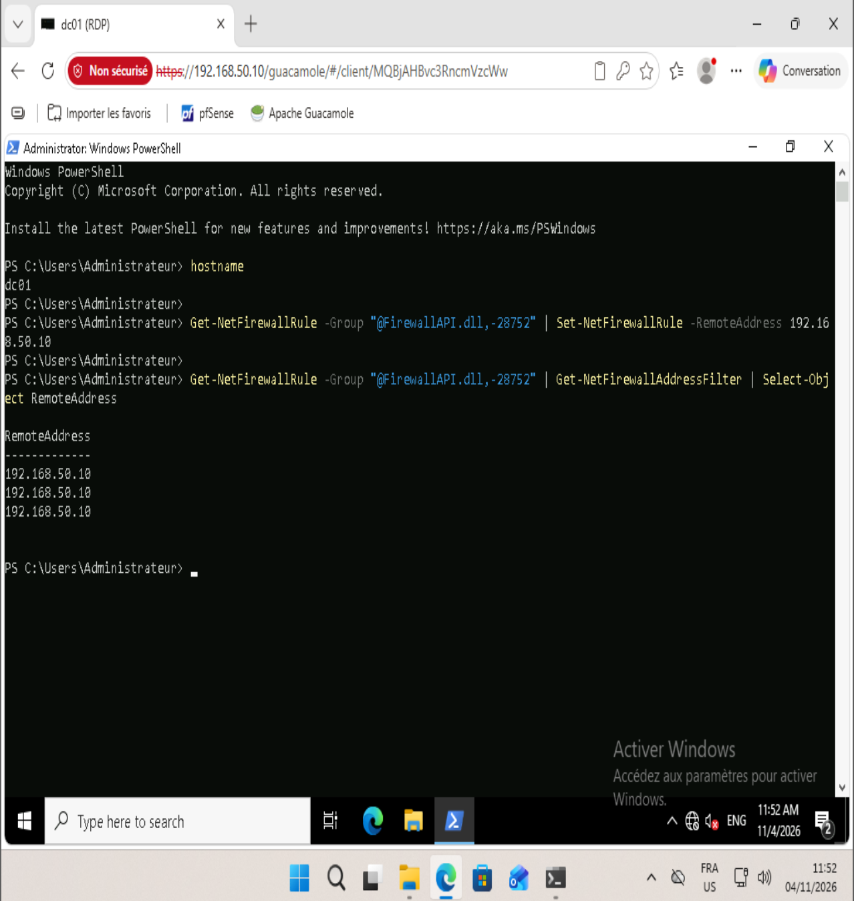

# Phase 10 — Durcissement et sauvegardes

Objectif : corriger la faille n°8 du TER (« snapshots ≠ sauvegardes ») et réduire les accès privilégiés. Une sauvegarde n'est considérée comme valable qu'après une restauration réussie.

## Sauvegardes

| Donnée | Où | Méthode | Fréquence | Rétention |
|---|---|---|---|---|
| Base `appdb` | db → `/var/backups/mariadb/` | `mariadb-dump --single-transaction` compressé | 02:00 (timer systemd) | 7 jours |
| Dumps de la base | bastion → `/srv/backups/db/` | collecte `scp` avec une clé dédiée | 03:00 | 14 jours |
| Configuration pfSense | bastion → `/srv/backups/pfsense/` | `scp` de `/cf/conf/config.xml` (SSH pfSense par clé uniquement) | 03:00 | 14 jours |
| Base Guacamole | bastion → `/srv/backups/bastion/` | `pg_dump` dans le conteneur | 03:00 | 14 jours |
| Configuration du bastion | bastion → `/srv/backups/bastion/` | archive `tar` (sans enregistrements ni clé TLS) | 03:00 | 14 jours |

Timers systemd avec `Persistent=true` : une exécution manquée (VM éteinte) est rattrapée au démarrage suivant.

### Sécurité des sauvegardes
- Clé SSH dédiée `backup@bastion`, restreinte sur db : `from="192.168.50.10",restrict` (utilisable depuis le bastion uniquement, sans terminal ni redirection).
- SSH de pfSense activé en **clé uniquement**, joignable depuis le bastion seulement (règle BASTION → BASTION address:22).
- Dossiers en `750` / fichiers en `640` ; aucune sauvegarde dans Git (`.gitignore`).

Fichiers : `configs/db/backup-mariadb.*`, `configs/bastion/collecte-sauvegardes.*`.

## Tests de restauration

| Scénario | Incident simulé | Restauration | Résultat |
|---|---|---|---|
| Base de données | `DROP TABLE appdb.services` : le site passe en erreur | Dump récupéré **depuis la copie du bastion**, puis réinjecté | 4 lignes restaurées en **0,13 s**, site rétabli |
| pfSense | Suppression de la règle NTP de la zone INVITES | Restauration du `config.xml` collecté | Règle revenue |

## Durcissement

| Mesure | Mise en œuvre | Preuve |
|---|---|---|
| SSH par clés uniquement | `10-durcissement.conf` sur bastion, db, web : `PasswordAuthentication no`, `PermitRootLogin no`, `MaxAuthTries 3`, `AllowUsers bouaroua` | `sshd -T` → `passwordauthentication no`, `permitrootlogin no` ; connexion par mot de passe : `Permission denied (publickey)` |
| SSH coupé sur guest | `systemctl disable --now ssh` | Aucun accès d'administration à la zone Invités |
| Fail2ban sur le bastion | jail `sshd`, `backend = systemd`, 3 essais / 10 min → ban 1 h | `fail2ban-client status sshd` actif |
| Comptes AD séparés | OU `Comptes/Admins` et `Comptes/Utilisateurs` ; `slimane` (quotidien, sans privilège) et `admin` (Admins du domaine) ; `Administrateur` conservé comme compte de secours | `Get-ADGroupMember` des Admins du domaine |
| RDP du DC limité au bastion | Pare-feu Windows : `RemoteAddress 192.168.50.10` sur les règles Bureau à distance | Session Guacamole OK ; règles filtrées sur 192.168.50.10 |
| Fuseau horaire | Europe/Paris sur toutes les VMs Debian (le template était en EST) | `date` → CET |

Fichier : `configs/10-durcissement.conf`.

Snapshot : `P10-durci`.

## Limites

- **Sauvegardes sur une seule machine collectrice** : le bastion réunit toutes les copies. La règle 3-2-1 demanderait une copie hors site et immuable (stockage objet, bande, serveur dédié). Si le bastion est compromis, les sauvegardes le sont aussi.
- **Pas de sauvegarde de l'état système du DC** (`wbadmin systemstatebackup`), qui nécessiterait un volume dédié.
- **Pas de blocage automatique des tentatives de connexion dans Guacamole** : le module `guacamole-auth-ban` n'est pas inclus dans l'image `guacamole:1.5.5` (extension absente au démarrage, variables `BAN_*` sans effet). Les échecs sont journalisés avec l'IP réelle du client, et le MFA rend un mot de passe deviné inutilisable seul.
- **Compte d'administration nommé `admin`** (AD et Guacamole) : c'est un nom facile à deviner. Le risque est réduit par un mot de passe fort et par le passage obligatoire par le bastion avec TOTP.
- La collecte stocke le `.env` du bastion (mot de passe PostgreSQL), nécessaire pour une restauration : `/srv/backups` doit rester en accès restreint.

## Difficultés

- **Clé ajoutée au mauvais endroit** : commandes lancées en root (`~` = `/root`) ou sur la mauvaise machine. Réflexe retenu : vérifier l'invite (`utilisateur@machine`) avant chaque commande, et tester une clé avec `-o BatchMode=yes` (sinon, un mot de passe saisi fait croire que la clé marche).
- **SSH de pfSense injoignable puis refusé** : la règle BASTION → port 22 manquait, puis la clé n'était pas enregistrée sur le compte `admin`.
- **`tar` en échec sur `bastion.key`** : la clé TLS appartient à l'UID 101 (Nginx) en `600`. Elle est exclue de l'archive : un certificat auto-signé se régénère, et une clé privée n'a pas sa place dans une sauvegarde.
- **Dump supprimé avant la restauration** : un bloc collé a enchaîné une restauration en échec (mauvais utilisateur) et le `rm` final. Règle retenue : ne jamais supprimer un fichier de restauration avant d'avoir vérifié le résultat.
- **`sudo` à distance** : impossible sans terminal pour le mot de passe. Solution : copie lisible dans `/tmp`, puis `scp`.
- **Mots de passe AD refusés** : `New-ADUser` crée le compte (désactivé) avant de refuser un mot de passe trop faible. Il faut ensuite utiliser `Set-ADAccountPassword` et `Enable-ADAccount`, au lieu de recréer le compte.
- **Règle de pare-feu appliquée sur la mauvaise machine** : la commande destinée au DC a d'abord été lancée sur Admin-40. `hostname` est désormais vérifié avant toute modification.
- **Copier-coller hôte → Admin-40 cassé** : réparé par la réinstallation (*Réparer*) des VMware Tools.